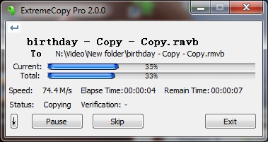

  

    
🌐 Language

    

      

        <a href="https://openaitx.github.io/view.html?user=kevinwu1024&project=ExtremeCopy&lang=en">English</a>
        | <a href="https://openaitx.github.io/view.html?user=kevinwu1024&project=ExtremeCopy&lang=zh-CN">简体中文</a>
        | <a href="https://openaitx.github.io/view.html?user=kevinwu1024&project=ExtremeCopy&lang=zh-TW">繁體中文</a>
        | <a href="https://openaitx.github.io/view.html?user=kevinwu1024&project=ExtremeCopy&lang=ja">日本語</a>
        | <a href="https://openaitx.github.io/view.html?user=kevinwu1024&project=ExtremeCopy&lang=ko">한국어</a>
        | <a href="https://openaitx.github.io/view.html?user=kevinwu1024&project=ExtremeCopy&lang=hi">हिन्दी</a>
        | <a href="https://openaitx.github.io/view.html?user=kevinwu1024&project=ExtremeCopy&lang=th">ไทย</a>
        | <a href="https://openaitx.github.io/view.html?user=kevinwu1024&project=ExtremeCopy&lang=fr">Français</a>
        | <a href="https://openaitx.github.io/view.html?user=kevinwu1024&project=ExtremeCopy&lang=de">Deutsch</a>
        | <a href="https://openaitx.github.io/view.html?user=kevinwu1024&project=ExtremeCopy&lang=es">Español</a>
        | <a href="https://openaitx.github.io/view.html?user=kevinwu1024&project=ExtremeCopy&lang=it">Italiano</a>
        | <a href="https://openaitx.github.io/view.html?user=kevinwu1024&project=ExtremeCopy&lang=ru">Русский</a>
        | <a href="https://openaitx.github.io/view.html?user=kevinwu1024&project=ExtremeCopy&lang=pt">Português</a>
        | <a href="https://openaitx.github.io/view.html?user=kevinwu1024&project=ExtremeCopy&lang=nl">Nederlands</a>
        | <a href="https://openaitx.github.io/view.html?user=kevinwu1024&project=ExtremeCopy&lang=pl">Polski</a>
        | <a href="https://openaitx.github.io/view.html?user=kevinwu1024&project=ExtremeCopy&lang=ar">العربية</a>
        | <a href="https://openaitx.github.io/view.html?user=kevinwu1024&project=ExtremeCopy&lang=fa">فارسی</a>
        | <a href="https://openaitx.github.io/view.html?user=kevinwu1024&project=ExtremeCopy&lang=tr">Türkçe</a>
        | <a href="https://openaitx.github.io/view.html?user=kevinwu1024&project=ExtremeCopy&lang=vi">Tiếng Việt</a>
        | <a href="https://openaitx.github.io/view.html?user=kevinwu1024&project=ExtremeCopy&lang=id">Bahasa Indonesia</a>
        | <a href="https://openaitx.github.io/view.html?user=kevinwu1024&project=ExtremeCopy&lang=as">অসমীয়া</
      

    

  

**NOTE: ~~[http://www.easersoft.com]~~ The Domain Lost, This Is No Longer Offical Site.**

# ExtremeCopy

ExtremeCopy is a Windows utility which copy and move files extremely fast, it will auto optimize speed and resources base on target physical machine.

**ExtremeCopy includes the following features:**

   * Copy or move files or folders with extremely fast.
   * Increase the file copying speed up to 20% to 120% in comparison the default Windows copying function.
   * Save much time when backup huge files to another hard drive or USB drive.
   * Easily manage copying task.
   * Able to calculate and display remain time exactly.
   * Supports Break Point which able to pause when encounters any problems such as file being locked and resume back with click on "Continue" button once the problem fixed.
   * Supports multiple languages.

For high performance purpose, all of code are written in C++ and using Win32 API directly.

ExtremeCopy uses email as bug report deliver to send dump file send to itself, setup your email account in **BugReport.cpp** if you want to use it.

For legacy paid version, there is **RegisterCodeGenerator** project can generate register code for it.

欢迎加入 ExtremeCopy 用户交流QQ群： 793476374
